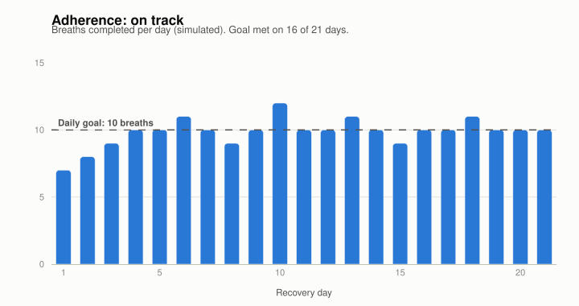
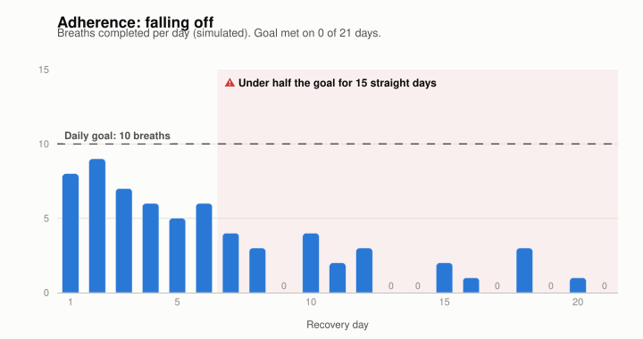
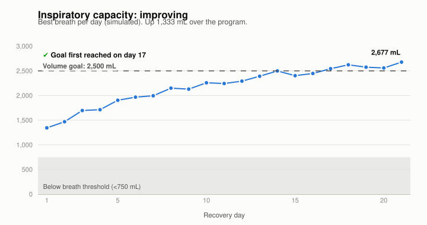
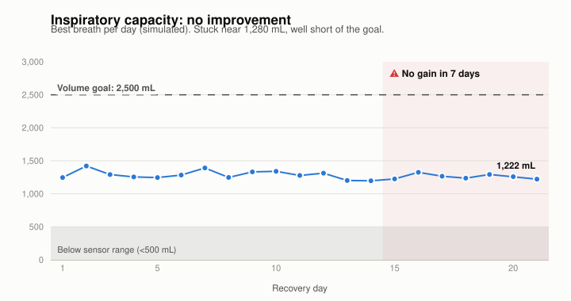
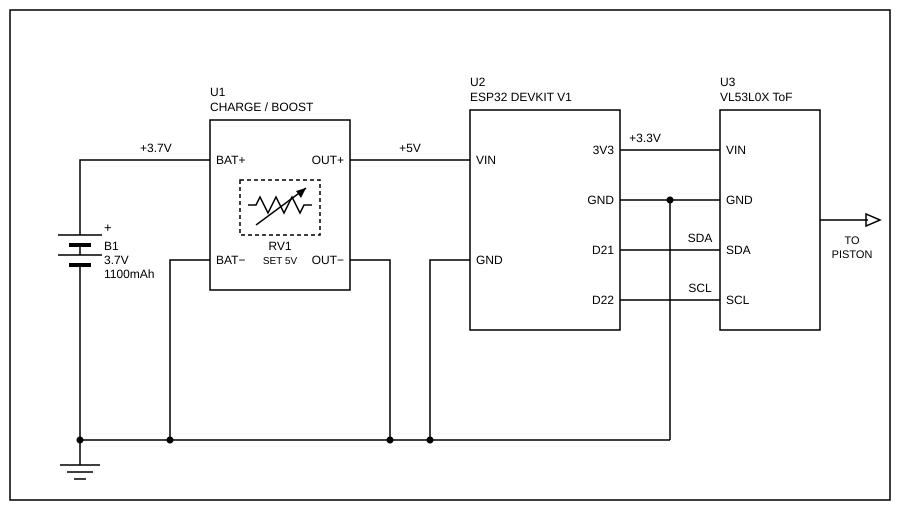

# Digital Spirometer

## Tracking

- An analog spirometer only shows the patient a number in the moment. Nothing gets recorded, so whether they actually did their breaths, and whether they're getting better, comes down to memory.
- This device logs every breath with a timestamp, so the care team can see two things over the recovery program: **adherence** (breaths done each day against the daily goal) and **inspiratory capacity** (best breath each day against the volume goal).
- Both can be flagged automatically, like when someone stops doing their breaths, or when their volume stops improving. That's a cue to check in early instead of finding out at the next appointment.
- The charts below use simulated data to show what on-track and flagged patients look like. Volumes under 750 mL are greyed out, since breaths that don't reach that level aren't recorded (see Limitations). They're made with Plotly. Each chart also has an interactive `.html` version in `charts/` with hover tooltips. To regenerate them, run `pip install -r charts/requirements.txt` and then `python3 charts/generate_charts.py`.

| On track | Flagged |
|---|---|
|  |  |
|  |  |

### Reading the charts

**Adherence**

- *On track:* The patient starts a little under the 10-breath goal (7–9 a day in the first three days), which is normal while they get used to the device. After that they settle at or just above it, meeting the goal on 16 of 21 days. Even the misses are only one breath short, so there's nothing to act on.
- *Falling off:* The patient starts out nearly on target, then drops off steadily. They average about 6 breaths a day in week one and 1 a day in week three, with 6 days where they did none at all. From day 7 on they never get back above half the goal, and that's what triggers the flag. A drop like this often means pain, low motivation, or not understanding why the exercise matters, so it's worth a call before the next visit.
- The flag is based on a sustained run of low days rather than a single bad day, so one missed day doesn't set it off.

**Inspiratory capacity**

- *Improving:* The best breath climbs from about 1,350 mL to about 2,680 mL. Most of the gain comes in the first 1–2 weeks, then it levels off near the goal, which is the shape you'd expect as the lungs recover. The patient first reaches the 2,500 mL goal on day 17 and stays above it for the rest of the program.
- *No improvement:* The best breath stays between about 1,200 and 1,420 mL for the whole three weeks and drifts slightly downward. It never gets close to the goal. The flag fires once there's been no gain for 7 days. This patient may still be doing their breaths every day, so adherence alone wouldn't catch this. It could point to a complication or poor technique, and it's a cue for the care team to take a closer look.
- Every value on both charts is well above the 750 mL breath threshold, so these trends are inside the range the device can measure reliably.

**Using both together**

Looking at the two metrics side by side tells the care team more than either one alone:

| Adherence | Capacity | What it suggests |
|---|---|---|
| On track | Improving | Recovery is going as planned |
| Falling off | Not improving | Likely an effort problem, so start with encouragement or a reminder |
| On track | Not improving | Doing the work but not getting better, so worth a clinical check |
| Falling off | Improving | Recovering anyway, but confirm they're keeping it up |

## Circuit

The device runs on a 3.7 V 1100 mAh Li-ion battery. The battery connects to a charge/boost module on BAT+ and BAT−. The module charges the battery and steps its output up to 5 V, which is set with the module's potentiometer. The module's output goes to the ESP32's VIN and GND pins, and the ESP32's onboard regulator turns that into 3.3 V. The VL53L0X time-of-flight sensor runs off the ESP32's 3V3 and GND pins and talks to it over I²C: SDA on D21 and SCL on D22.

## Enclosure

`spirometer-base-assem-final.STL` is the 3D-printable base for the device. It's a single binary STL exported from SolidWorks, about 134 × 30 × 76 mm. Open it in any slicer (Cura, PrusaSlicer, Bambu Studio) to print it.

## Database

- Breath data is stored in Supabase in the `sessions` table, one row per breath (volume, duration, peak flow, outcome, check-in answers). Rows are keyed on device ID + timestamp, so re-sending a record updates it instead of making a duplicate.
- The ESP32 doesn't connect to the internet. The phone does the syncing: after a breath is saved, and again after the check-in, the web app pulls the last 20 records off the device and pushes them all to Supabase.
- The phone needs internet while it's on the SmartSpirometer network, which usually means cellular data. If a sync fails nothing is shown, and it just retries after the next breath. The device only keeps 20 records, so a breath can get dropped if it isn't synced before it falls off the end.

## Limitations

- Volume is measured with a VL53L0X time-of-flight sensor pointed at the piston. It's cheap and easy to wire up, but it isn't very accurate at close range. Below about 40 mm the readings bunch up and can even go backwards, so anything under ~500 mL can't be told apart from an empty chamber.
- Because of that, a breath only counts once the volume passes 750 mL. That's when timing starts and the score begins tracking. The extra margin above the ~500 mL blind spot keeps sensor noise from starting a breath by accident. Any breath that peaks below 750 mL won't register at all. While waiting for a breath, the app shows anything under 500 mL as 0 so the noise doesn't flicker on screen.
- Readings are also a bit noisy, so they're averaged over a few samples, which slows the response slightly.
- A more precise (and more expensive) ToF sensor built for short range would fix most of this. It could pick up the small piston movements at the bottom of the chamber, which would let the device measure lower volumes and start timing a breath sooner.
